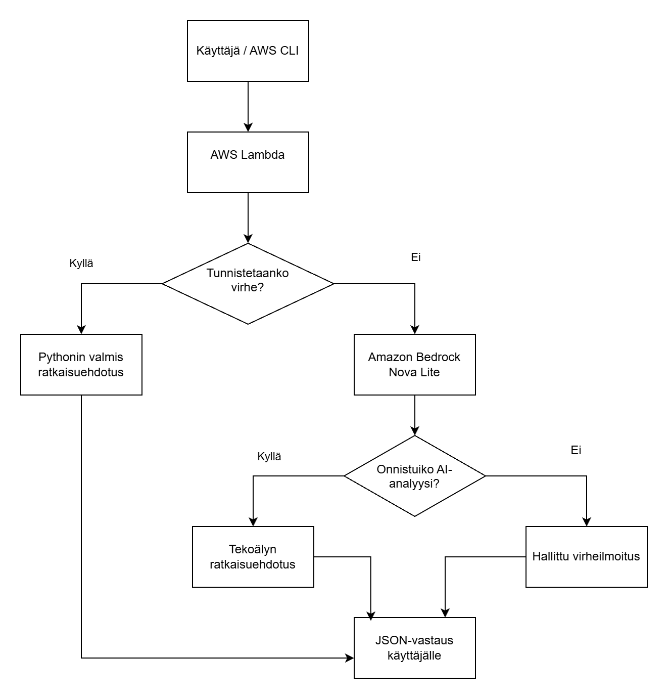

# AWS Cloud Troubleshooter

AWS Cloud Troubleshooter on Pythonilla tehty harjoitusprojekti, joka analysoi AWS-palveluiden virheilmoituksia ja ehdottaa niihin ratkaisuja.

Ohjelma yrittää ensin tunnistaa virheen valmiiden Python-sääntöjen avulla. Jos virhettä ei tunnisteta, ohjelma käyttää Amazon Bedrockin Nova Lite -tekoälymallia.

Sovellusta voidaan käyttää paikallisesti tai AWS Lambda -palvelussa.

## Miten ohjelma toimii?

- Tunnistaa yleisiä AWS-virheitä ja antaa niihin valmiit ratkaisuehdotukset.
- Analysoi tuntemattomia virheitä Amazon Bedrockin Nova Lite -mallilla.
- Käyttää tekoälyä vain silloin, kun virhettä ei tunnisteta omilla säännöillä.
- Käsittelee Bedrockin virhetilanteita hallitusti.
- Palauttaa analyysin JSON-muodossa AWS Lambdasta.

## Sovelluksen toimintavuokaavio

## Käytetyt teknologiat

- Python – ohjelman toiminta ja virheiden tunnistaminen
- AWS Lambda – ohjelman suorittaminen pilvessä
- Amazon Bedrock – tekoälyanalyysi
- Terraform – AWS-infrastruktuurin asetusten hallinta
- GitHub Actions – automaattiset testit ja tarkistukset

## Testaus

Projektissa on 9 automaattista testiä.

Testit voidaan suorittaa komennolla:

python -m unittest discover -v

Testit eivät tee oikeita tekoälykutsuja AWS:ään.

## Paikallinen käyttö

Ohjelman voi käynnistää projektikansiossa komennolla:

python troubleshooter.py

Ohjelma pyytää käyttäjältä virheilmoituksen ja ehdottaa mahdollista ratkaisua.

Tuntemattomien virheiden tekoälyanalyysi vaatii AWS-käyttöoikeudet ja voi aiheuttaa kustannuksia.

## AWS-ympäristö

Terraformilla hallitaan Lambda-funktion asetuksia ja käyttöoikeuksia.

Ohjelmakoodi on julkaistu AWS Lambda -palveluun AWS CLI avulla.

GitHub Actions suorittaa testit ja Terraform-tarkistukset, mutta ei vielä julkaise ohjelmaa automaattisesti AWS:ään.